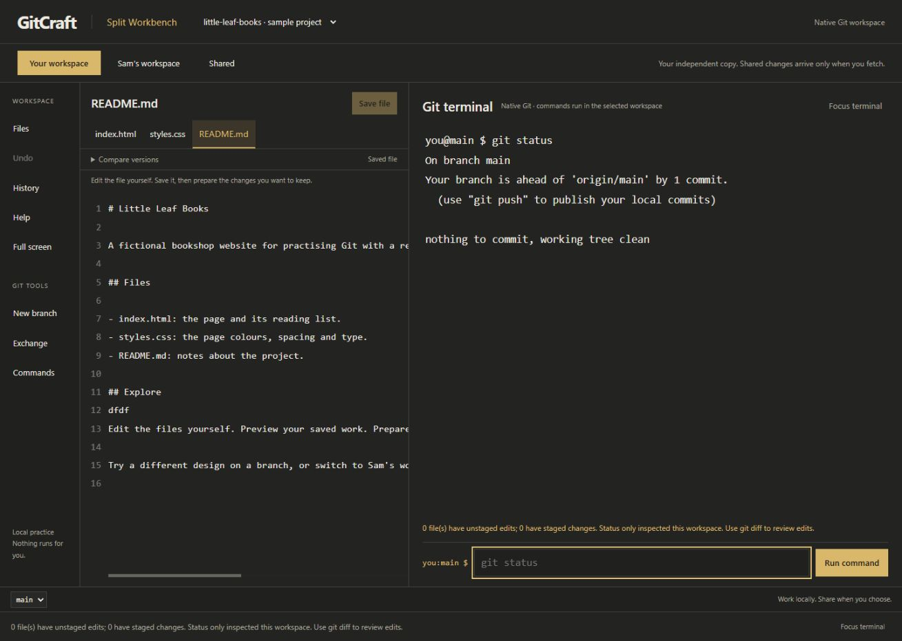
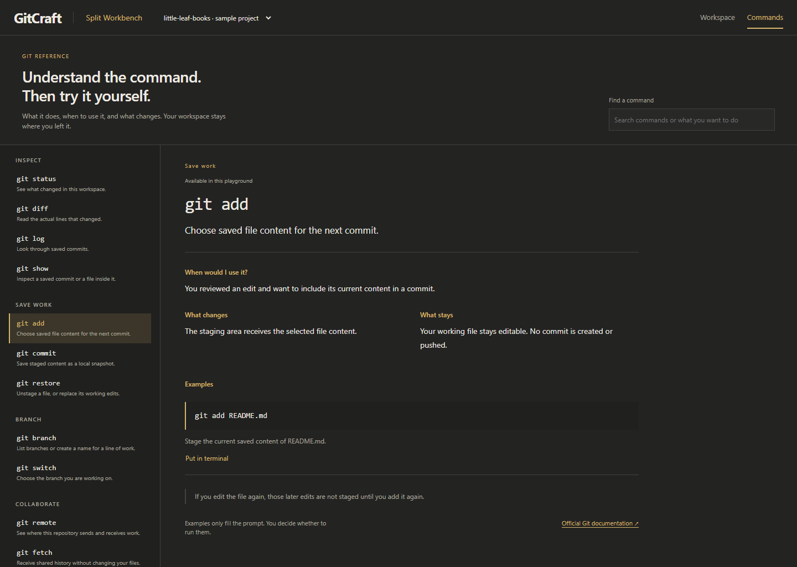

# GitCraft

**v0.1.0 — a local workspace for learning Git by using Git.**

Run real Git commands, inspect their results, and make your own changes in a small sample project. Switch between your workspace, Sam’s independent copy, and a shared repository to explore how collaboration works.



## Run locally

Requirements: **Python 3.10+** and **Git** on your PATH. The app uses Python’s standard library and buildless HTML/CSS/JavaScript; no frontend installation is required.

```sh
python -S -m gitcraft.server
```

Open [GitCraft](http://127.0.0.1:8765/). Use `--port 8766` if you need another port. Stop the server with Ctrl+C.

Practice repositories are disposable and are removed when this server stops. They are separate from this source repository and your personal projects.

## Explore

- **Workspace:** edit the sample files on the left and run Git commands in the terminal on the right. Save a file explicitly before staging its content.
- **Your workspace / Sam / Shared:** inspect separate real clones and their shared bare repository. Switching views never fetches, merges or authors changes.
- **Commands:** use the top navigation to search explanations for 16 commands, including what changes, what stays and examples. A practice example only fills the prompt; you decide whether to run it. Setup commands and `pull` are marked reference-only.
- **Help and History:** open them from the sidebar when needed. History reflects real commits and branch references.
- **Undo:** restore the entire practice project before its last mutating action. This is a GitCraft convenience, not a standard Git command. Unsaved browser drafts remain separate.

One possible exploration: `git status` → edit and save README.md → `git diff` → `git add README.md` → `git diff --staged` → `git commit -m "Describe your change"`. You choose the change and the message. There is no required lesson order, score or attempt penalty.



## Scope of this first version

This is a **single-learner local prototype**, not a publicly hosted execution sandbox. The terminal invokes native Git through a bounded command gateway; it is not a general system shell.

- Three supplied project files, each limited to 8 KB.
- Up to 12 branches per workspace and 60 visible known commits.
- Supported practice operations cover inspection, staging, commits, branches, fetch, merge and push to the local Shared repository.
- No arbitrary repository imports, GitHub authentication, live multiplayer, AI grading, production hosting or external remotes.
- Git installation, credentials and ordinary team review remain part of later real-world practice. Beginner learning outcomes have not yet been validated in a learner study.

Repository inspection reuses unchanged views and batches file reads. Local measurements and validation notes are in [design-qa.md](design-qa.md); timings vary by machine and operation.

## Checks

Python checks require native Git and create disposable fixtures:

```sh
python -S -m unittest discover -s tests -v
```

JavaScript checks require Node.js:

```sh
node --test tests/test_lessons.mjs tests/test_playground.mjs
```

The current validation includes 26 Python tests, 12 JavaScript checks, and desktop/mobile browser checks for navigation, command suggestions, draft preservation and unchanged repository state while browsing help.

## Product and design notes

- [Current direction](PLAYGROUND-DIRECTION.md)
- [Product context](PRODUCT.md) and [design direction](DESIGN.md)
- [Research, curriculum and proposed PRD](docs/product-intelligence/README.md)

Earlier research documents include historical proposals; the running workspace and Commands page represent this first implementation. Screenshots and timing samples are reviewed project evidence. Local runtime repositories, downloaded browsers, machine-specific helper scripts and unrelated documents are excluded from version control.
