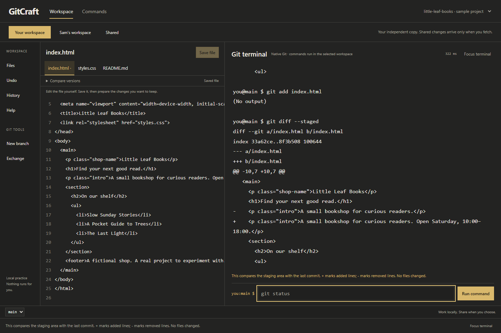
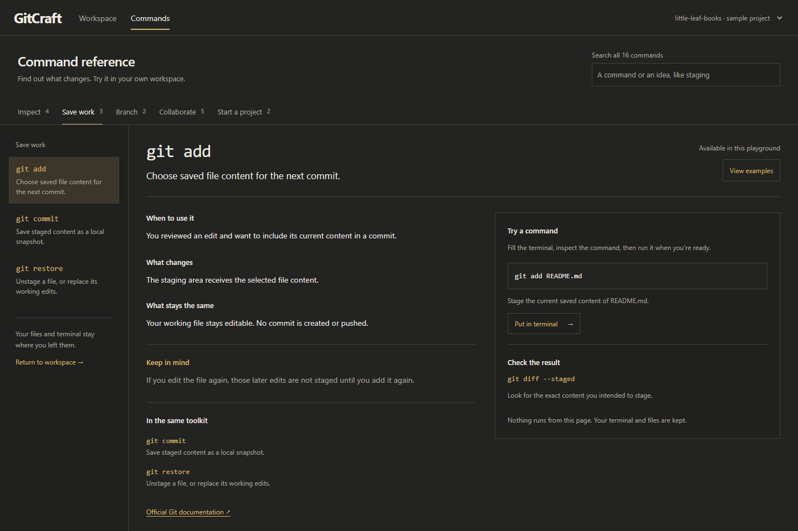
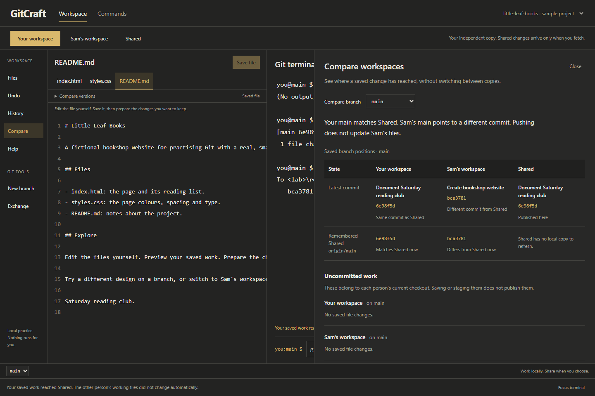
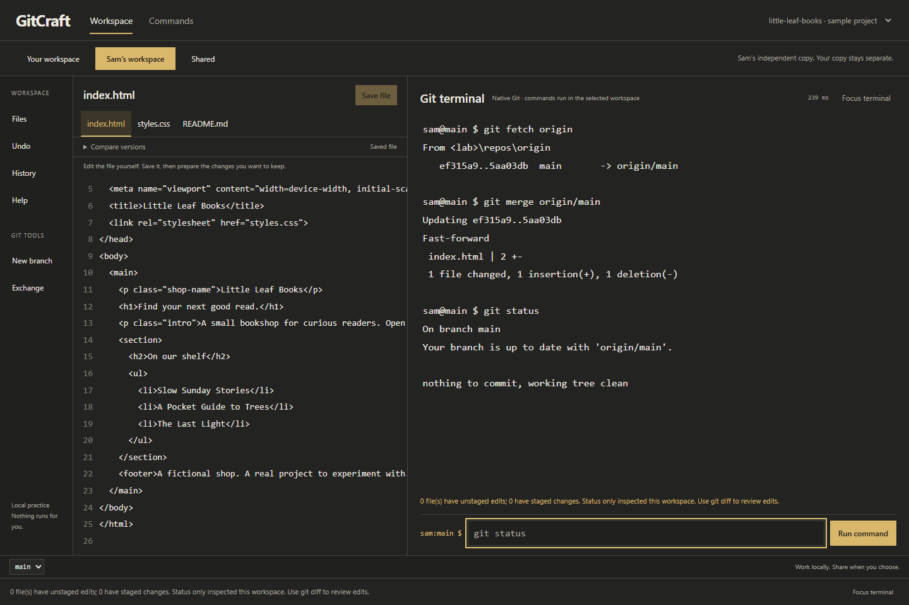
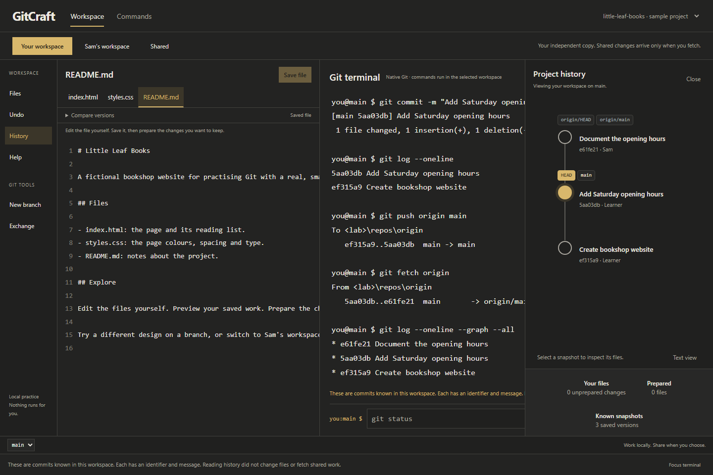

# GitCraft

**Learn Git in a workspace where you can see what your commands change.**

Edit a small bookshop website, run real Git commands, and explore separate copies of the same project. GitCraft is an interactive playground: you choose what to change, when to commit, and what to share. There are no required lessons, scores, or penalties for asking for help.



*The editor supplies changes to investigate. The terminal is where you inspect, stage, commit, branch, and share them.*

[Get started](#get-started) · [Your first commit](#make-your-first-commit) · [Collaboration](#try-collaboration) · [Help](#find-help-and-recover-from-mistakes) · [Limits](#current-limits)

## Get started

You need **Python 3.10+**, **Git**, and a modern browser. Python and Git must be available on your PATH. Node.js is only needed for JavaScript tests; there is no frontend build or dependency installation.

In your **computer's terminal**, clone this repository and start the app:

```sh
git clone https://github.com/blakc-coffee/gitcraft.git
cd gitcraft
python -S -m gitcraft.server
```

Open **[http://127.0.0.1:8765/](http://127.0.0.1:8765/)** in your browser. If that port is occupied, use `python -S -m gitcraft.server --port 8766` and open the address printed by the server. On Windows, `py -3` can replace `python` if that is how Python is installed.

GitCraft creates **Little Leaf Books**, a fictional bookshop project, for you. You do not need to create or connect a repository inside the app. Stop the server with Ctrl+C in your computer's terminal.

**Practice is temporary.** Stopping the server removes its practice repositories. Browser editor drafts may remain locally, but they are not a backup of your commits or practice session. Your personal projects and this source checkout are separate from the disposable practice repositories.

## Find your way around

| Control | What it does |
| --- | --- |
| **Workspace** | Opens the editor and Git terminal. Type a command, then press Enter or **Run command**. |
| **Your workspace / Sam's workspace / Shared** | Switches between two independent copies and their shared repository. Switching does not fetch, merge, or make edits. You control both people. |
| **File tabs + Save file** | Opens `index.html`, `styles.css`, or `README.md`. Saving writes a draft to the working file; it does not stage or commit it. |
| **Compare versions** | Shows the working file, prepared/staged content, or last committed content. These versions can differ. |
| **Commands** | Opens searchable explanations and examples. Your editor draft and terminal transcript stay in place. |
| **Files** | Opens file states, optional Git helpers, and **Preview saved site**. The preview uses saved files. |
| **History** | Shows actual commits and branch references. Select a commit to inspect its files; **Text view** provides a list. |
| **Compare** | Compares a branch across Your workspace, Sam and Shared, including remembered remote refs and uncommitted work. Reading it runs no commands. |
| **Help** | Offers explanations and optional ideas to explore. |
| **New branch / Exchange** | Helps compose branch, fetch, merge, and push commands. Helpers fill the prompt; you still submit it yourself. |
| **Undo** | Restores the whole playground to before its last mutating action, including other workspaces and Shared. This is one-step recovery, not standard Git undo. |

Use **Focus terminal** for more room for Git output; **Show editor** brings the editor back. In Workspace, Ctrl/Cmd+S saves the current editable draft. Up/Down in the command field recalls that workspace's commands from this browser session.

## Make your first commit

This optional example adds opening hours to the sample website. Run these Git commands **inside GitCraft's terminal**, with **Your workspace** selected.

1. Run `git status` to see the current branch and file states.
2. Open **index.html**. Find `A small bookshop for curious readers.` and add ` Open Saturday, 10:00–18:00.` to that paragraph. Click **Save file**.
3. Run `git diff`. You should see the old and new lines. Saving changed the working file; nothing is staged yet.
4. Run `git add index.html` to stage its current saved content.
5. Run `git diff --staged` to review exactly what the next commit will contain. The first screenshot shows this point.
6. Run `git commit -m "Add Saturday opening hours"` to create a local snapshot.
7. Run `git log --oneline` to find your commit, then `git status` to check what remains uncommitted.

The distinction to explore is **save → stage → commit**. Saving writes the file, `git add` selects its current content, and `git commit` records that staged content in local history. If you edit again after staging, those later edits remain unstaged until you add them again.

To see the page itself, open **Files → Preview saved site**. You can change the reading list, try different styles, or write project notes instead of following this example.

## Look up a command without losing your place



Open **Commands** in the top navigation. Browse **Inspect**, **Save work**, **Branch**, **Collaborate**, or **Start a project**, or search all 16 entries by command or intent, such as `stage`.

Each entry explains when to use the command, what changes, what stays unchanged, and how to check the result. **View examples** takes you to the examples. **Put in terminal** returns to Workspace and fills the prompt; it never executes the command. Read it, adjust file or branch names if needed, then submit it yourself.

`init`, `clone`, and `pull` are **reference-only** here. The practice repositories already exist. Receiving work is split into fetch and merge so you can inspect each effect.

## Compare workspaces

Open **Compare** in the left sidebar after a commit, push, or fetch. Choose a branch to see where its saved commit has reached, what each person remembers about Shared, and any uncommitted work in their current checkout.



This helps explain why pushing does not update Sam's files, or why fetching does not merge a branch. Browser drafts are labelled separately from saved files. **What is this useful for?** inside the drawer explains the distinctions. On small screens, scroll the comparison table sideways.

Opening Compare does not fetch, merge, stage or save anything; it uses the latest state inspected by GitCraft. Different commit IDs are not treated as proof that a branch is ahead or behind. Close the drawer or press Escape to return to the workspace.

## Try collaboration

One learner controls **two independent clones**. A push does not instantly update everyone's files.

| Place | What lives there |
| --- | --- |
| **Your workspace** | Your working files, staging area, local branches, and commits. |
| **Sam's workspace** | Another copy with its own files, staging area, branches, and commits. You make Sam's contributions yourself. |
| **Shared** | A local bare repository holding published history. It has no working folder to edit; inspect it through History. |

After the first-commit example, move your opening-hours change to Sam:

1. In **Your workspace**, run `git push origin main`. This publishes committed work to Shared; it does not send unsaved edits or change Sam's files.
2. Switch to **Sam's workspace** and inspect `index.html`. Switching alone has not received your update.
3. Run `git fetch origin`. Sam now knows about published commits, but her working files have not been merged.
4. Run `git merge origin/main`, then `git status`. Sam's branch now includes your change. Open `index.html` to inspect it.



To explore the other direction, stay in Sam's workspace, add a short visit note to `README.md`, and save it. Run `git add README.md`, `git commit -m "Document the opening hours"`, and `git push origin main`. Return to Your workspace and run `git fetch origin`, then open **History** before merging.



*This is a real fetched state: Shared's known branch has moved, while your local main has not yet integrated the commit.*

Run `git merge origin/main` when you want to bring that work into your branch. If you deliberately make competing edits in both copies, Git may report a conflict. Inspect the affected file, decide how to combine the changes, then stage and commit the resolved version.

## Explore a branch

In either person's workspace, run `git switch -c reading-list`. Make and commit a different reading-list change, then run `git switch main` to compare files on main. Use `git branch` to see the branch names.

To bring your branch's committed changes into main, stay on main and run `git merge reading-list`. Creating a branch does not publish it; sharing is a separate action. Save drafts before commands that change repository state so Git uses the file content you can see.

## Find help and recover from mistakes

- **Not sure what happened?** Start with `git status`. Use `git diff` for unstaged changes and `git diff --staged` for staged changes. An empty diff does not necessarily mean all versions match.
- **Staged the wrong file?** `git restore --staged index.html` removes it from staging while keeping its working-file edits.
- **Want to discard unstaged edits?** `git restore index.html` replaces the working file with its staged version. Review the diff first: this discards those unstaged edits.
- **Need to recover a playground action?** Use **Undo**. It restores the whole fixture, not just the visible person's copy. Unsaved browser drafts are kept separately.
- **Want a fresh start?** Open **Help → Reset this playground** and review the confirmation. Reset returns all three repositories to the starting state; it can be undone as the latest mutating action.
- **Command rejected?** Read the message and look up its supported form in Commands. This is a bounded Git terminal, not a general shell for `cd`, `ls`, or package installers.

## Current limits

GitCraft is a **single-learner local prototype**. Commands run native Git, but the environment is intentionally limited:

- Three supplied project files, up to 8 KB each; up to 12 branches per workspace and 60 visible known commits.
- Practice supports inspection, staging, commits, branches, fetch, merge, and push to local Shared. Not every option of these Git commands is accepted.
- No arbitrary repository imports, external remotes, GitHub login, live multiplayer, AI grading, or production execution hosting. `origin` here points to local Shared, not GitHub.
- Installing Git, using an ordinary terminal, authenticating with a hosting service, and team review require practice outside this app. A suggested [real-Git transfer task](docs/TRANSFER-TASK.md) is included.

Beginner learning outcomes have not yet been validated in a learner study. Future plans are proposals, not shipped functionality.

## Development and checks

The server uses Python's standard library; the frontend is plain HTML, CSS, and JavaScript modules.

| Location | Purpose |
| --- | --- |
| `gitcraft/engine.py` | Disposable repositories, bounded native Git commands, state inspection, and recovery. |
| `gitcraft/server.py` | Local HTTP API and static app serving. |
| `gitcraft/web/` | Workspace, command reference, styles, and interaction logic. |
| `tests/` | Backend/native Git regression checks and JavaScript logic checks. |

Run Python checks with Git available on PATH:

```sh
python -S -m unittest discover -s tests -v
```

Run JavaScript checks with Node.js:

```sh
node --test tests/test_lessons.mjs tests/test_playground.mjs
```

These screenshots were captured from the running app in a separate disposable session. The first-commit and two-way collaboration examples were executed against native Git. Browser checks used isolated headless Chromium without accessing a personal browser profile.

For more detail, see [validation notes](design-qa.md), [performance implementation and measurements](docs/PERFORMANCE.md), [product context](PRODUCT.md), [design decisions](DESIGN.md), and [research, curriculum, and proposed PRD](docs/product-intelligence/README.md). Research includes historical alternatives; this README describes the current app.
